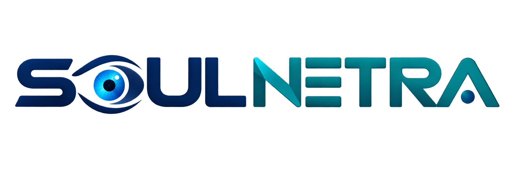
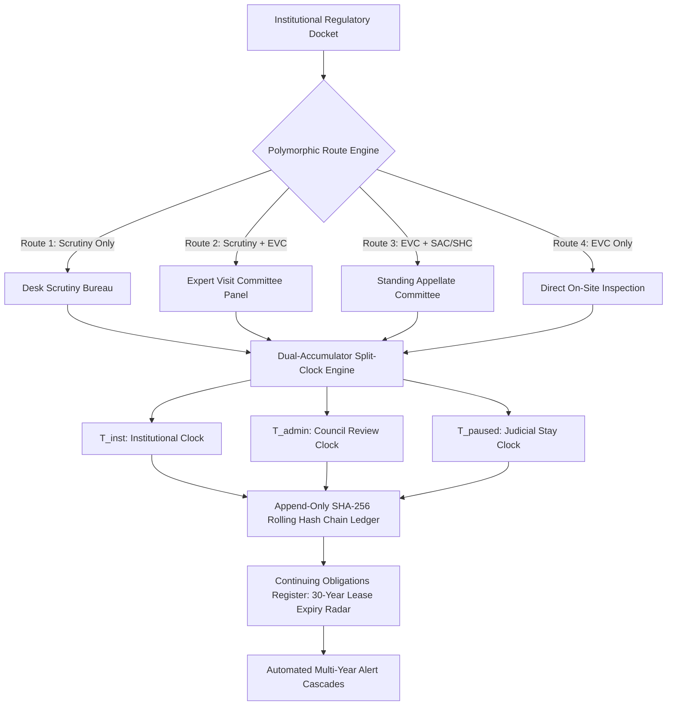

<p align="center">
  
</p>

<h1 align="center">SOUL NETRA</h1>

<p align="center">
  <strong>S</strong>ystem for <strong>O</strong>versight, <strong>U</strong>nified <strong>L</strong>ifecycle &mdash; <strong>N</strong>etwork for <strong>E</strong>valuation, <strong>T</strong>racking, <strong>R</strong>eporting &amp; <strong>A</strong>ccountability
</p>

<p align="center">
  <em>An Explainable, Rule-Version-Aware Regulatory Workflow Orchestration &amp; Continuing Compliance Monitoring Engine for AICTE Approval Processes</em>
</p>

<p align="center">
  <strong>Smart India Hackathon 2026</strong> &bull; <strong>Problem Statement ID: SIH26262</strong><br>
  <strong>Ministry of Education / All India Council for Technical Education (AICTE)</strong> &bull; <strong>Smart Automation Track</strong>
</p>

<p align="center">
  <a href="#-stakeholder-ecosystem--beneficiaries"></a>
  <a href="#-stakeholder-ecosystem--beneficiaries"></a>
  <a href="#-stakeholder-ecosystem--beneficiaries"></a>
  <a href="#-intellectual-property--copyright-notice"></a>
  <a href="#-key-architectural-innovations"></a>
  <a href="#-key-architectural-innovations"></a>
</p>

---

## 🏛️ Executive Overview

**SOUL NETRA** (**S**ystem for **O**versight, **U**nified **L**ifecycle — **N**etwork for **E**valuation, **T**racking, **R**eporting & **A**ccountability) is an explainable, rule-version-aware regulatory orchestration and continuing compliance monitoring engine engineered for the **All India Council for Technical Education (AICTE)**, Ministry of Education, Government of India under **Problem Statement SIH26262**.

Existing transactional portals (such as e-Governance and nPortal) ingest institutional forms and emit Extension of Approval (EoA) or Letter of Approval (LoA) PDF certificates. However, they operate as **transactional data-intake repositories rather than lifecycle governance systems**:
1. **Post-Approval Amnesia:** Conditional undertakings dissolve into unindexed PDF attachments without an automated follow-up engine.
2. **Multi-Year Validity Blind Spots:** 30-year registered land lease deeds and municipal building permits expire after decades without multi-year proactive alert pipelines.
3. **Bureaucratic Finger-Pointing:** Monolithic "Pending" statuses obscure whether delays stem from institutional delinquencies or internal administrative review latency during judicial scrutiny.

**SOUL NETRA introduces an explainable, rule-version-aware orchestration plane that operates cleanly above transactional portals to provide end-to-end regulatory accountability.**

---

## 👥 Stakeholder Ecosystem & Beneficiaries

SOUL NETRA is engineered to serve and coordinate across five major institutional, regulatory, and public stakeholder groups:

| Stakeholder Group | Specific Entities & Roles | Core Regulatory Pain Point Solved | Dedicated Portal / Touchpoint |
| :--- | :--- | :--- | :--- |
| **1. Central Apex Regulatory Authority** | **AICTE Headquarters, New Delhi**<br>&bull; Member Secretary &amp; Chairman<br>&bull; Approval Bureau Officers<br>&bull; Policy &amp; Academic Handbook Cell | Solves bureaucratic amnesia, unindexed post-approval undertakings, and rule-version obsolescence across academic handbook revisions (APH 2024–27). | **Central Orchestration Engine**<br>&bull; Statutory Calendar Config<br>&bull; National Pendency Dashboard |
| **2. Regional Scrutiny & Council Officers** | **AICTE Regional Offices (ROs)**<br>&bull; WRO Mumbai, NRO Kanpur, SRO Chennai, etc.<br>&bull; Regional Officers &amp; Scrutiny Committees<br>&bull; Expert Visiting Committees (EVC / SAC) | Eliminates institutional finger-pointing in High Court writ petitions; automatically pauses Council SLA review clock whenever a formal deficiency is issued to an applicant. | **Scrutiny Desk (`#/scrutiny`)**<br>&bull; Split-Clock Attribution ($T_{\text{admin}}$)<br>&bull; Rule-Cited Deficiency Issuance<br>&bull; EVC Scheduling Workbench |
| **3. Regulated Technical Institutions (Applicants)** | **Technical Colleges &amp; Universities**<br>&bull; Principals, Directors &amp; Registrars<br>&bull; Deans &amp; Accreditation Coordinators<br>&bull; Sponsoring Educational Trusts / Societies | Provides transparent statutory countdown timers, prevents arbitrary rejections via clear APH rule citations, and tracks multi-year recurring obligations (e.g., 30-yr land leases, annual fire NOCs). | **Institution Portal (`#/institution`)**<br>&bull; Real-time Docket Tracking<br>&bull; Deficiency Rectification Center<br>&bull; 2-Phase Document Vault<br>&bull; Continuing Obligations Calendar |
| **4. Oversight, Judicial &amp; Audit Bodies** | **Statutory Watchdogs &amp; Courts**<br>&bull; Comptroller &amp; Auditor General (CAG)<br>&bull; Central Vigilance Commission (CVC)<br>&bull; High Courts &amp; Supreme Court of India | Directly addresses CAG Performance Audit Reports (28/2017 &amp; 23/2021) on pendency. Delivers mathematical non-repudiation and tamper detection via append-only SHA-256 rolling hash chains. | **Audit Ledger Portal (`#/audit-ledger`)**<br>&bull; Linear Tamper Verifier<br>&bull; SHA-256 Hash Chain Explorer<br>&bull; Cryptographic Audit Certificate |
| **5. Public Beneficiaries &amp; Civil Society** | **Citizens, Students &amp; Parents**<br>&bull; Aspiring Engineering &amp; Tech Students<br>&bull; Parents &amp; Guardian Associations<br>&bull; Educational Transparency Advocates | Protects students from unapproved courses or fraudulent admissions; delivers instant, zero-trust verification of valid Extension of Approval (EOA) letters without exposing proprietary source code. | **Public Verify Desk (`#/public-verify`)**<br>&bull; Instant PID / College Search<br>&bull; Sanctioned Intake Lookup<br>&bull; Fire Safety Clearance Status |

---

## 🚀 Key Architectural Innovations



### 1. Dual-Accumulator Split-Clock Delay Attribution ($T_{\text{inst}}$ vs. $T_{\text{admin}}$)
Maintains two independent, millisecond-accurate Riemann accumulators partitioning delay based on active regulatory custody. Resolves institutional delinquency vs. administrative review latency with a formal overlapping wait policy, eliminating bureaucratic blame-shifting.

### 2. Four Declarative Polymorphic Route Topologies
Dynamically binds applications to one of 4 statutory trajectories (`ONLY_SCRUTINY`, `SCRUTINY_EVC`, `EVC_SAC_SHC`, `ONLY_EVC`) based on institution classification, strictly preventing illegal stage bypasses.

### 3. Rule-Version-Aware Statutory Deadline Engine
Computes legally explainable cut-off dates excluding Sundays and state-specific gazetted public holidays, while dynamically adapting to cycle-specific Supreme Court calendar modifications (*Parshvanath Charitable Trust* doctrine).

### 4. Two-Phase Evidence Verification State Machine
Separates digital file upload from regulatory closure by enforcing that $\text{SUBMISSION} \neq \text{VERIFICATION}$. Upholds 6 deterministic composite compliance states requiring certified officer sign-off.

### 5. Append-Only Cryptographic SHA-256 Audit Ledger
Records immutable event blocks chained via Merkle-Damg&aring;rd linked tokens ($H_i = \text{SHA-256}(H_{i-1} \mathbin{\Vert} \text{Actor} \mathbin{\Vert} \text{Action} \mathbin{\Vert} \text{Payload})$). Implements an $O(N)$ linear tamper-detection algorithm that pinpoints the exact block height of any retrospective database mutation.

---

## 💻 Working Web Application & Distinct Endpoints

The repository contains a complete, zero-backend-dependency Single Page Application (SPA) with dedicated functional endpoints and role-based authentication:

- **`#/` (Overview & Architecture):** Executive summary, core pillars, interactive sandboxes, and cloud infrastructure costing.
- **`#/institution` (Institution Portal):** Live application docket `AICTE-2026-ENG-4921`, deficiency response center, 2-phase document vault, and continuing obligations tracker.
- **`#/scrutiny` (Scrutiny Desk):** Regional officer queue, APH 2024–27 statutory checklist, and deficiency issuance tool.
- **`#/audit-ledger` (Audit Ledger):** Interactive SHA-256 rolling block stream, linear tamper simulation, verification check, and audit certificate export.
- **`#/sla-analytics` (SLA Analytics):** Live dual-accumulator split-clock meters, custody clock transfer, and statutory holiday calculator.
- **`#/public-verify` (Public Verification):** Public citizen portal to search technical colleges by PID or Name, verify approved intake, and view valid approvals with zero source-code exposure.
- **Role-Based Authentication:** Instant 1-click personas (Institution Head, AICTE Officer, CAG Auditor, Public Citizen) and custom login credentials with persistent session state.

### Running Locally

```bash
# Clone the repository
git clone https://github.com/Aditya948351/SIH26262.git
cd SIH26262/Main_Implementation

# Launch using any static file server or directly open in your browser
# Option 1: Python HTTP Server
python -m http.server 8000

# Option 2: Node npx serve
npx serve .

# Now open http://localhost:8000 in your browser
```

---

## 📂 Repository File Structure

```
Main_Implementation/
├── index.html               # Multi-endpoint Single Page Application (SPA)
├── styles.css               # Ultra-modern liquid-glass design system (Dark & Light modes)
├── app.js                   # Client SPA router, role-based auth, split-clock & WebCrypto ledger
├── logo.png                 # Official SOUL NETRA Platform Logo
├── .gitignore               # Standard git ignore rules
├── README.md                # Comprehensive repository documentation & stakeholder matrix
├── docs/
│   └── SOUL_NETRA_Copyright_Technical_Report.pdf  # 35-Page Protected Copyright Technical Dossier
└── code_assets/
    ├── schema.sql           # PostgreSQL 16 11-table relational DDL & audit triggers
    ├── workflow_engine.py   # Polymorphic state machine & split-clock accumulator
    ├── audit_ledger.py      # Rolling SHA-256 hash chain & O(N) tamper verification
    ├── deadline_worker.py   # Working-day statutory calculator & holiday deduplication
    ├── api_router.py        # FastAPI route controller, RBAC guards & tenant isolation
    └── code_bundle.js       # Bundled client simulation routines
```

---

## ☁️ MeitY MeghRaj / GeM Cloud Sizing & Feasibility

Grounded in standard Government e-Marketplace (GeM) cloud catalog pricing (October 2026):

| Infrastructure Component | Scenario 1: Prototype / Sandbox | Scenario 2: Regional Pilot | Scenario 3: Multi-Regional Scale |
| :--- | :--- | :--- | :--- |
| **Target Sizing** | 5 Test Colleges (Localhost) | 50 Colleges / 300 Filings | 2,500 Colleges / 10,000 Filings |
| **Compute / API Pods** | Local Docker | 2x K8s Pods (2 vCPU, 4GB RAM) | 3x K8s Pods (4 vCPU, 8GB RAM) |
| **PostgreSQL 16 DB** | Local PostgreSQL 16 | Single-Node Postgres (4 vCPU, 16GB) | Multi-AZ HA Primary + Replica (8 vCPU, 32GB) |
| **Redis Cluster (Queue)** | Local Redis | Single Redis Node (2 GB RAM) | 3-Node Redis Cluster (4 GB RAM) |
| **Encrypted Storage** | Local Disk Adapter | 250 GB Encrypted Object Store | 5 TB NVMe Encrypted Object Store |
| **Monthly Operating Cost** | **₹0 – ₹1,500 / month** | **₹28,500 / month** | **₹83,000 / month** |
| **Annual Operating TCO** | **~₹18,000 / year** | **~₹3,42,000 / year (~3.42 L)** | **~₹9,96,000 / year (~9.96 L)** |

> **Cost-Benefit Ratio:** At **₹9.96 Lakhs per year** for 2,500 institutions, SOUL NETRA accounts for less than **0.08% of AICTE's annual administrative automation budget**, delivering positive operational return on investment within 6 months.

---

## 📜 Intellectual Property & Copyright Notice

This software architecture, database design, mathematical formulations, and source code are registered under **Section 2(o), Section 13(1)(a), and Section 45 of the Indian Copyright Act, 1957 read with Rule 70 of the Copyright Rules, 2013** (Form XIV).

- **Full Documentation Dossier:** [`docs/SOUL_NETRA_Copyright_Technical_Report.pdf`](docs/SOUL_NETRA_Copyright_Technical_Report.pdf) *(35 Pages, Vector PDF with Digital Watermarking)*
- **Statutory Fair Dealing Citation:** Official regulatory handbooks (APH 2024–27) and Supreme Court judgments (*(2013) 3 SCC 385*) are cited strictly for administrative research under Section 52(1)(q) of the Copyright Act, 1957.

---

## 👥 Joint Authors & Engineering Team

All six team members share equal academic responsibility, joint intellectual property ownership, and co-authorship credit:

| Author | Engineering Portfolio & Deliverables |
| :--- | :--- |
| **Aditya Patil** | Backend Developer &amp; ML Engineer (State Machine Engine, REST API, Celery Workers) |
| **Rasik Dhage** | Team Lead, Hosting &amp; Research, Website Development, Aligning Frontend &amp; Backend, CI/CD |
| **Dipila Pawar** | Frontend Developer &amp; UI/UX Architect (Web Application, Role Dashboards, Timelines) |
| **Vaishnavi Ganjare** | Researcher: Regulatory Law &amp; CAG Performance Audits (Supreme Court Jurisprudence) |
| **Shraddha Sabale** | PPT Development &amp; Core Systems Research (Flowcharts, Impact Reduction Metrics) |
| **Janhvi Sapra** | CI/CD Manager &amp; Security Governance (Automated Pytest Harness, DPDP Act 2023) |

---

*Academic Cycle: 2026–2027 • Smart India Hackathon 2026 • Problem Statement ID: SIH26262 • Ministry of Education / AICTE*
