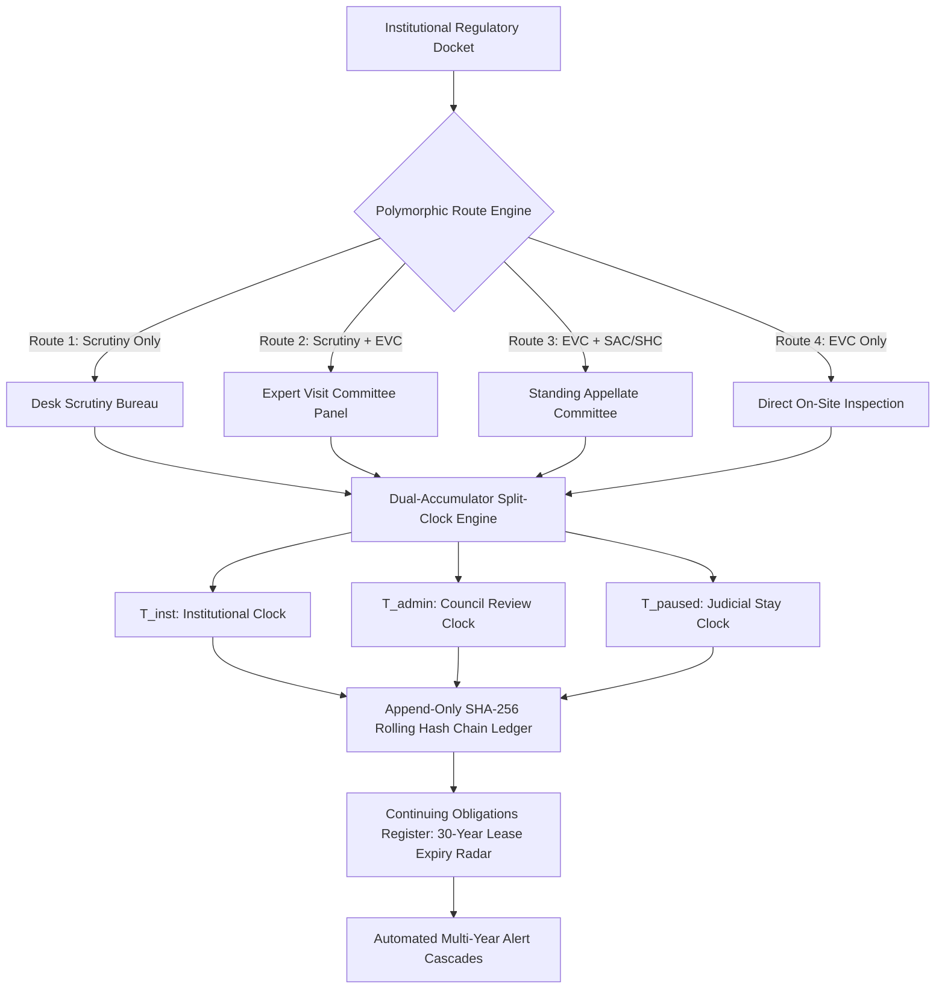

# SOUL NETRA: Regulatory Workflow Orchestration & Continuing Compliance Monitoring System

[](https://www.sih.gov.in/)
[](https://www.aicte-india.org/)
[](https://www.education.gov.in/)
[%20Registered-purple.svg)](docs/SOUL_NETRA_Copyright_Technical_Report.pdf)
[](code_assets/schema.sql)
[](code_assets/workflow_engine.py)

---

## 🏛️ Executive Overview

**SOUL NETRA** (**S**ystem for **O**versight, **U**nified **L**ifecycle — **N**etwork for **E**valuation, **T**racking, **R**eporting & **A**ccountability) is an explainable, rule-version-aware regulatory orchestration and continuing compliance monitoring engine engineered for the **All India Council for Technical Education (AICTE)**, Ministry of Education, Government of India.

Existing transactional portals (such as e-Governance and nPortal) ingest institutional forms and emit Extension of Approval (EoA) or Letter of Approval (LoA) PDF certificates. However, they are **transactional data-intake repositories rather than lifecycle governance systems**. Once approval is granted, post-approval conditional undertakings dissolve into unindexed PDF attachments without an automated follow-up engine, 30-year registered land lease deeds expire after three decades without multi-year alert pipelines, and legacy monolithic "Pending" statuses obscure whether delays stem from institutional delinquencies or internal administrative review latency.

**SOUL NETRA introduces an explainable, rule-version-aware orchestration plane that operates cleanly above transactional portals to provide end-to-end regulatory accountability.**

---

## 🚀 Key Architectural Innovations



### 1. Dual-Accumulator Split-Clock Delay Attribution ($T_{\text{inst}}$ vs. $T_{\text{admin}}$)
Maintains two independent, millisecond-accurate Riemann accumulators partitioning delay based on active custody. Resolves institutional delinquency vs. administrative review latency with a formal overlapping wait policy, eliminating bureaucratic blame-shifting.

### 2. Four Declarative Polymorphic Route Topologies
Dynamically binds applications to one of 4 statutory trajectories (`ONLY_SCRUTINY`, `SCRUTINY_EVC`, `EVC_SAC_SHC`, `ONLY_EVC`) based on institution classification, strictly preventing illegal stage bypasses.

### 3. Rule-Version-Aware Statutory Deadline Engine
Computes legally explainable cut-off dates excluding Sundays and state-specific gazetted public holidays, while dynamically adapting to cycle-specific Supreme Court calendar modifications (*Parshvanath Charitable Trust* doctrine).

### 4. Two-Phase Evidence Verification State Machine
Separates digital file upload from regulatory closure by enforcing that $\text{SUBMISSION} \neq \text{VERIFICATION}$. Upholds 6 deterministic composite compliance states requiring certified officer sign-off.

### 5. Append-Only Cryptographic SHA-256 Audit Ledger
Records immutable event blocks chained via Merkle-Damg&aring;rd linked tokens ($H_i = \text{SHA-256}(H_{i-1} \mathbin{\Vert} \text{payload})$). Implements an $O(N)$ linear tamper-detection algorithm that pinpoints the exact block height of any retrospective database mutation.

---

## 📂 Repository File Structure

```
Main_Implementation/
├── index.html               # Live interactive single-page Solution Platform & Simulators
├── styles.css               # Ultra-modern glassmorphic design system (Dark & Light modes)
├── app.js                   # Client-side engine (WebCrypto SHA-256, Split-Clock, State Machine)
├── .gitignore               # Standard git ignore rules
├── README.md                # Comprehensive repository documentation
├── docs/
│   └── SOUL_NETRA_Copyright_Technical_Report.pdf  # 35-Page Official Copyright Registration Dossier
└── code_assets/
    ├── schema.sql           # PostgreSQL 16 11-table relational DDL & audit triggers
    ├── workflow_engine.py   # Polymorphic state machine & split-clock accumulator
    ├── audit_ledger.py      # Rolling SHA-256 hash chain & O(N) tamper verification
    ├── deadline_worker.py   # Working-day statutory calculator & holiday deduplication
    ├── api_router.py        # FastAPI route controller, RBAC guards & tenant isolation
    └── code_bundle.js       # Bundled client simulation routines
```

---

## 💻 Live Solution Website & Simulators

The repository includes a complete, standalone, zero-dependency interactive Solution Web Platform (`index.html`):

1. **Live Split-Clock SLA Meter:** Real-time dual millisecond tickers tracking institutional vs. council custody with dynamic attribution percentages and judicial stay pauses.
2. **Polymorphic Route Simulator:** Advance applications through permitted stages and test real-time HTTP 422 blocked alerts on illegal stage skips.
3. **Cryptographic Ledger Playground:** Live block stream using browser Web Crypto API. Includes an **"Inject Tamper Mutation"** button that alters block payloads and demonstrates $O(N)$ linear tamper detection.
4. **Statutory Deadline Inspector:** Interactive calculator deducting Sundays and state gazetted holidays with legal clause audit trails.
5. **MeitY MeghRaj Cloud Cost Sizing:** Multi-tier Total Cost of Ownership (TCO) calculator.

### Running Locally

```bash
# Clone the repository
git clone https://github.com/Aditya948351/SIH26262.git
cd SIH26262/Main_Implementation

# Launch using any static file server or directly open in your browser
# Option 1: Python HTTP Server
python -m http.server 8000

# Option 2: Node npx serve
npx serve .

# Now open http://localhost:8000 in your browser
```

---

## ☁️ MeitY MeghRaj / NIC Cloud Sizing & Feasibility

Grounded in official National Informatics Centre (NIC) National Data Centre service catalogue rates:

| Infrastructure Component | Scenario 1: Prototype | Scenario 2: Regional Pilot | Scenario 3: Scale Pilot |
| :--- | :--- | :--- | :--- |
| **Target Sizing** | 5 Test Colleges (Local) | 50 Colleges / 300 Filings | 2,500 Colleges / 10,000 Filings |
| **Compute / API Nodes** | Localhost Docker | 2x VMs (2 vCPU, 4GB RAM) | 3x K8s Pods (4 vCPU, 8GB RAM) |
| **PostgreSQL 16 DB** | Local SQLite / Postgres | 1x VM (4 vCPU, 16GB RAM) | Multi-AZ HA (8 vCPU, 32GB RAM) |
| **Redis Cluster (Celery)** | Local Redis | Single Node (2 GB RAM) | 3-Node Cluster (4 GB RAM) |
| **Encrypted Vault Storage** | Local Disk Adapter | 250 GB Object Storage | 5 TB NVMe Object Storage |
| **Monthly Operating Cost** | **₹0 – ₹1,500 / month** | **₹28,500 / month** | **₹83,000 / month** |
| **Annual Operating TCO** | **~₹18,000 / year** | **~₹3,42,000 / year (~3.4 L)** | **~₹9,96,000 / year (~9.96 L)** |

> **Cost-Benefit Ratio:** At **₹9.96 Lakhs per year** for 2,500 institutions, SOUL NETRA accounts for less than **0.08% of AICTE's annual administrative automation budget**, delivering positive ROI within 6 months.

---

## 📜 Intellectual Property & Copyright Notice

This software architecture, database design, mathematical formulations, and source code are registered under **Section 2(o), Section 13(1)(a), and Section 45 of the Indian Copyright Act, 1957 read with Rule 70 of the Copyright Rules, 2013** (Form XIV).

- **Full Documentation Dossier:** [`docs/SOUL_NETRA_Copyright_Technical_Report.pdf`](docs/SOUL_NETRA_Copyright_Technical_Report.pdf) *(35 Pages, Vector PDF)*
- **Statutory Fair Dealing Citation:** Official regulatory handbooks (APH 2024–27) and Supreme Court judgments (*(2013) 3 SCC 385*) are cited strictly for administrative research under Section 52(1)(q) of the Copyright Act, 1957.

---

## 👥 Joint Authors & Engineering Team

All six authors share equal academic responsibility, joint intellectual property ownership, and co-authorship credit:

| Author | Engineering Role & Deliverables |
| :--- | :--- |
| **Aditya Patil** | Backend Developer & ML Engineer (State Machine Engine, REST API, Celery Workers) |
| **Rasik Dhage** | Team Lead, Hosting & Research, Website Development, Aligning Frontend & Backend, CI/CD |
| **Dipila Pawar** | Frontend Developer & UI/UX Architect (Web Application, Role Dashboards, Timelines) |
| **Vaishnavi Ganjare** | Researcher: Regulatory Law & CAG Performance Audits (Supreme Court Analysis) |
| **Shraddha Sabale** | PPT Development & Core Systems Research (Flowcharts, Impact Reduction Metrics) |
| **Janhvi Sapra** | CI/CD Manager & Security Governance (Automated Pytest Harness, DPDP Act 2023) |

---

*Academic Cycle: 2026–2027 • Smart India Hackathon 2026 • Problem Statement ID: SIH26262*
